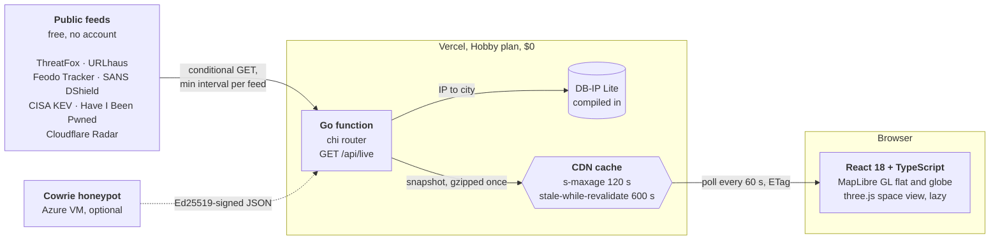
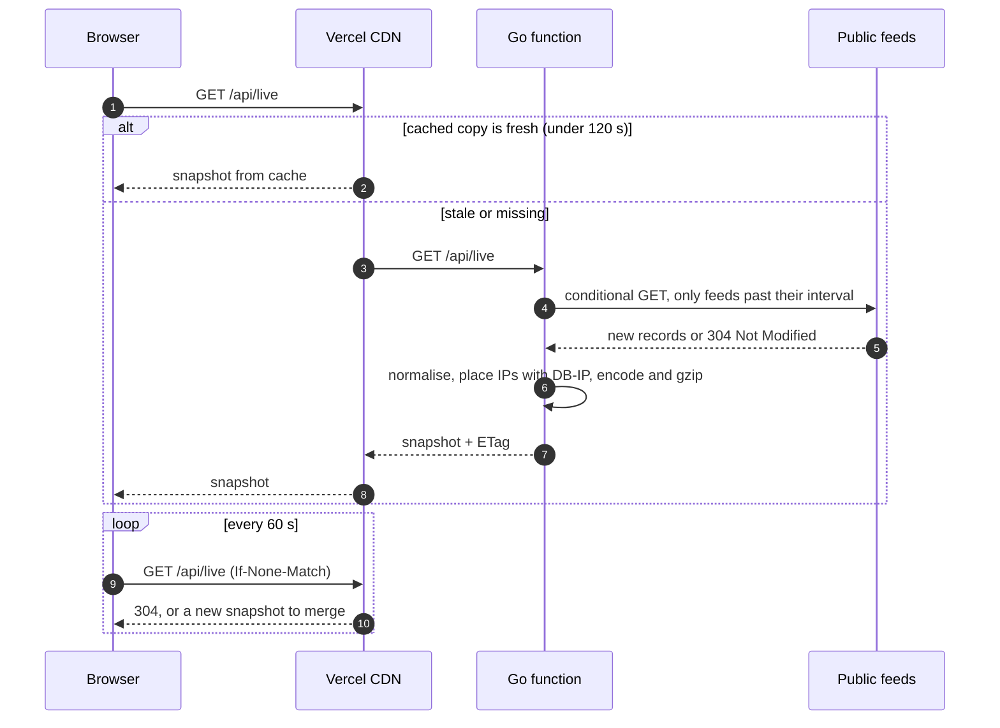
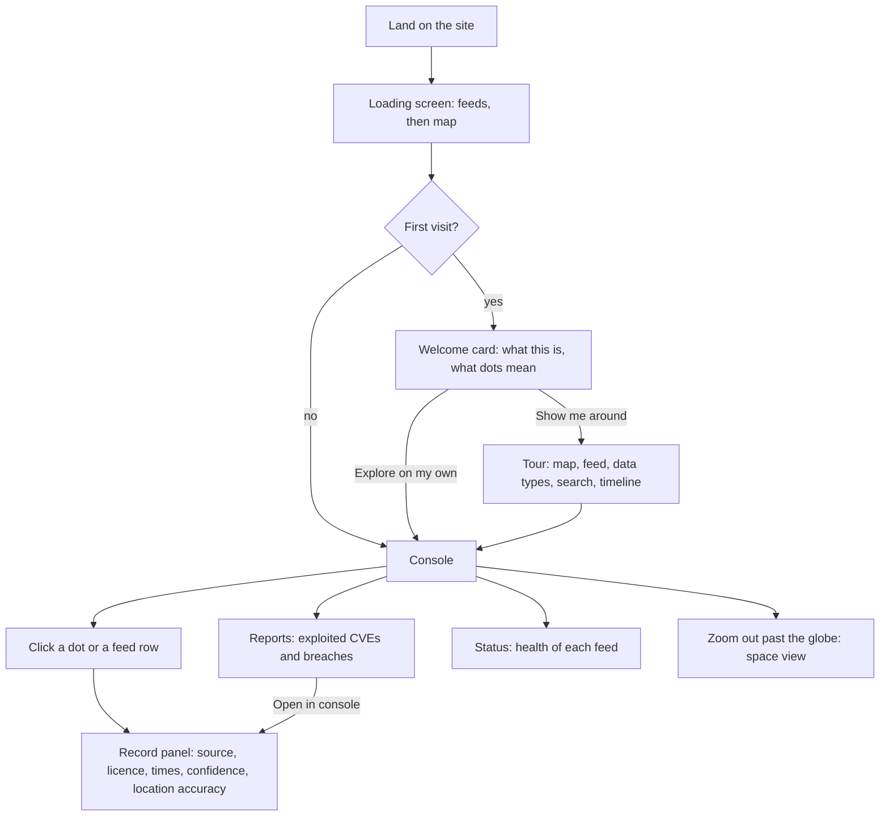

<p align="center">
  
</p>

<h1 align="center">BreachScope</h1>

<p align="center">
  A live map of cyber threats reported by public security feeds, honest about where every record came from.<br>
  <a href="https://breachscope-live.vercel.app"><b>Open the live site</b></a>
</p>

<p align="center">
  
</p>

**In one sentence:** a Go API pulls six free threat-intelligence feeds, places every reported IP at its city, and a React and MapLibre front end shows the result on a globe, with the source, licence and location accuracy on every record. It runs for $0 a month.

## Try it in one minute

1. **Open the [live site](https://breachscope-live.vercel.app).** A short welcome explains what you are looking at. Choose **Show me around** for a six-step tour of the real controls.
2. **Click any dot.** The panel shows what was reported (for example a botnet control server), who reported it, when, under what licence, and how precise the location is.
3. **Open the feed** (the list icon on the left) to see every record, newest first. Press `J` and `K` to step through them.
4. **Filter by data type** in the top bar: Indicators, Exploited CVEs, Breaches.
5. **Search** for an IP, ASN, CVE, country or malware family with `Cmd K`.
6. **Open Reports** for exploited vulnerabilities and breaches, and **Status** for the health of each feed.
7. **Keep zooming out** past the globe to leave Earth for a 3D Solar System with real planet positions.

## How it works



**Why it is built this way**

- **One upstream fetch, however many visitors.** Each feed has a minimum refresh interval and is fetched with conditional GETs. The API response is cached by the CDN, so a spike in visitors never turns into a spike in requests to the feed operators. A test proves 20 simultaneous visitors cause one upstream request.
- **Encode once, serve many.** The snapshot is serialised and gzipped once per refresh (1.4 MB to 175 KB), not once per request.
- **Location stays honest.** DB-IP Lite gives a city with no published accuracy, and the panel says exactly that. When only the country is known, the country is shaded instead of a dot being drawn at its centre.
- **Lines only when both ends are exact.** Feeds name single addresses, so they are points. The only arcs come from our own honeypot, where we know both the attacker's address and our sensor.

### What happens on one page view



### What a visitor sees



## What it does

- **Live map of real threats.** C2 servers, malware hosts, scanning sources, exploited vulnerabilities and disclosed data breaches, pulled from public feeds and refreshed every few minutes.
- **Accurate placement.** Every IP is placed at its city with DB-IP. If only the country is known, the country is shaded instead of a fake dot being drawn at its centre.
- **Provenance on every record.** Source, licence, timestamps, confidence and how precise the location is.
- **A guided first visit.** A welcome card and a short tour that points at the real controls, adapted to desktop, tablet and phone.
- **Flat or globe, street-level detail.** Zoom from the whole planet down to street names. Keep zooming out and you leave Earth for the Solar System and beyond.
- **Works everywhere.** Desktop, tablet and phone layouts, keyboard navigation and reduced-motion support, checked with automated accessibility tests.

## Tech

| Area | Choice |
|---|---|
| Frontend | React 18, TypeScript, Vite, MapLibre GL (globe and flat), three.js, OpenFreeMap tiles |
| Backend | Go (chi, pgx), deployed as a Vercel function, also builds as a Docker image |
| Data | ThreatFox, URLhaus, Feodo Tracker, SANS DShield, CISA KEV, Have I Been Pwned, Cloudflare Radar, DB-IP Lite |
| Database | Postgres 16 schema with cursor paging and a resumable SSE stream (ready for the next stage) |
| Testing | Go race tests with Testcontainers, Vitest, Playwright with axe at four screen sizes, load and soak tests |
| Hosting | Vercel and GitHub Actions, $0 a month |

## Repository layout

| Path | What is there |
|---|---|
| `api/index.go` | Vercel entry point. Wraps the same router the Docker image runs |
| `pkg/feeds` | One file per source: fetch, rate limit, normalise. Includes the signed honeypot reader |
| `pkg/geoip` | DB-IP Lite lookups, compiled into the binary for Vercel |
| `pkg/httpapi` | Routes: `/api/live`, `/api/healthz`, and the database-backed `/api/events` and `/api/stream` |
| `pkg/store`, `pkg/stream`, `pkg/db` | Postgres schema, cursor paging and the resumable SSE stream |
| `cmd/` | Local API server, migration tool and an SSE soak checker |
| `web/src` | React app: `components/` UI, `map/` MapLibre layers, `space/` three.js view, `lib/` data hooks |
| `web/e2e` | Playwright suites: layouts, accessibility, onboarding, space view, 30-poll soak |
| `infra/azure` | Terraform and a one-command Cloud Shell script for the optional honeypot |

Each module has a short `NOTES.md` explaining how it works and why.

## Engineering highlights

- **Polite to data providers.** Each feed has a minimum refresh interval, requests use conditional GETs and identify the project, and the API response is CDN-cached, so visitor traffic never multiplies upstream traffic.
- **Fast under load.** In a local load test the API served 20,000 requests at 200 concurrent with zero errors and zero data races.
- **No lost events.** The SSE stream resumes from `Last-Event-ID`. A test drops the connection at random points while four writers insert events, then checks nothing is missing or duplicated.
- **Stable in the browser.** A soak test runs 30 heavy polls (about 7,500 new events) with constant interaction across all breakpoints: no errors and flat memory.
- **Signed sensor data.** The honeypot's export is signed with Ed25519, and the API only accepts records that verify against the embedded public key.

## Run it locally

```sh
sh scripts/fetch-geo.sh          # DB-IP databases (free, no account)
docker compose up -d --build     # API on :8080
cd web && npm install && npm run dev
```

Open http://localhost:5173.

## Tests

```sh
go vet ./... && staticcheck ./... && go test -race ./...   # Docker needed for the Postgres tests
cd web && npm run typecheck && npm run lint && npm test && npm run test:e2e
```

## Data and licences

ThreatFox, URLhaus and Feodo Tracker (abuse.ch, CC0) · SANS ISC DShield (CC BY-NC-SA 4.0) · Cloudflare Radar (CC BY-NC 4.0) · CISA KEV (CC0) · Have I Been Pwned (CC BY 4.0) · DB-IP Lite (CC BY 4.0) · Natural Earth (public domain) · OpenFreeMap and © OpenStreetMap contributors.

Non-commercial project. IP location identifies a network, not a person. Arcs between places are only drawn when a source names both ends.
