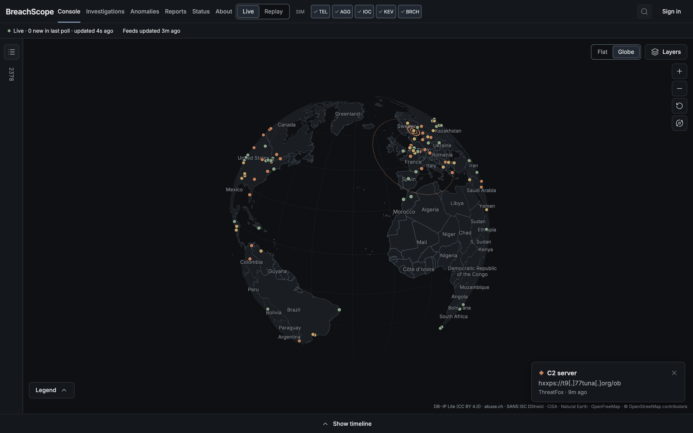

<p align="center">
  
</p>

<h1 align="center">BreachScope</h1>

<p align="center">
  A live threat-intelligence map built on real public data, honest about where every record came from.<br>
  <a href="https://breachscope-live.vercel.app"><b>Open the live site</b></a>
</p>

<p align="center">
  
</p>

## What it does

- **Live map of real threats.** C2 servers, malware hosts, scanning sources, exploited vulnerabilities and disclosed data breaches, pulled from six public feeds and refreshed every few minutes.
- **Accurate placement.** Every IP is placed at its city with DB-IP. If only the country is known, the country is shaded instead of a fake dot being drawn at its centre.
- **Provenance on every record.** Source, licence, timestamps, confidence and how precise the location is.
- **Flat or globe, street-level detail.** Zoom from the whole planet down to street names. Keep zooming out and you leave Earth for the Solar System and beyond.
- **Works everywhere.** Desktop, tablet and phone layouts, keyboard navigation and reduced-motion support, checked with automated accessibility tests.

## Tech

| Area | Choice |
|---|---|
| Frontend | React 18, TypeScript, Vite, MapLibre GL (globe and flat), OpenFreeMap tiles |
| Backend | Go (chi, pgx), deployed as a Vercel function |
| Data | ThreatFox, URLhaus, Feodo Tracker, SANS DShield, CISA KEV, Have I Been Pwned, DB-IP Lite |
| Database | Postgres 16 schema with cursor paging and a resumable SSE stream (ready for the next stage) |
| Testing | Go race tests with Testcontainers, Vitest, Playwright with axe at four screen sizes, load and soak tests |
| Hosting | Vercel and GitHub Actions, $0 a month |

## Engineering highlights

- **Polite to data providers.** Each feed has a minimum refresh interval, requests use conditional GETs and identify the project, and the API response is CDN-cached, so visitor traffic never multiplies upstream traffic. A test proves 20 simultaneous visitors cause one upstream request.
- **Fast under load.** The live snapshot is encoded and gzipped once per refresh (1.4 MB to 175 KB). In a local load test the API served 20,000 requests at 200 concurrent with zero errors and zero data races.
- **No lost events.** The SSE stream resumes from `Last-Event-ID`. A test drops the connection at random points while four writers insert events, then checks nothing is missing or duplicated.
- **Stable in the browser.** A soak test runs 30 heavy polls (about 7,500 new events) with constant interaction across all breakpoints: no errors and flat memory.

## Run it locally

```sh
sh scripts/fetch-geo.sh          # DB-IP databases (free, no account)
docker compose up -d --build     # API on :8080
cd web && npm install && npm run dev
```

Open http://localhost:5173.

## Tests

```sh
go vet ./... && go test -race ./...          # Docker needed for the Postgres tests
cd web && npm run typecheck && npm run lint && npm test && npm run test:e2e
```

## Data and licences

ThreatFox, URLhaus and Feodo Tracker (abuse.ch, CC0) · SANS ISC DShield (CC BY-NC-SA 4.0) · CISA KEV (CC0) · Have I Been Pwned (CC BY 4.0) · DB-IP Lite (CC BY 4.0) · Natural Earth (public domain) · OpenFreeMap and © OpenStreetMap contributors.

Non-commercial project. IP location identifies a network, not a person. Arcs between places are only drawn when a source names both ends.
